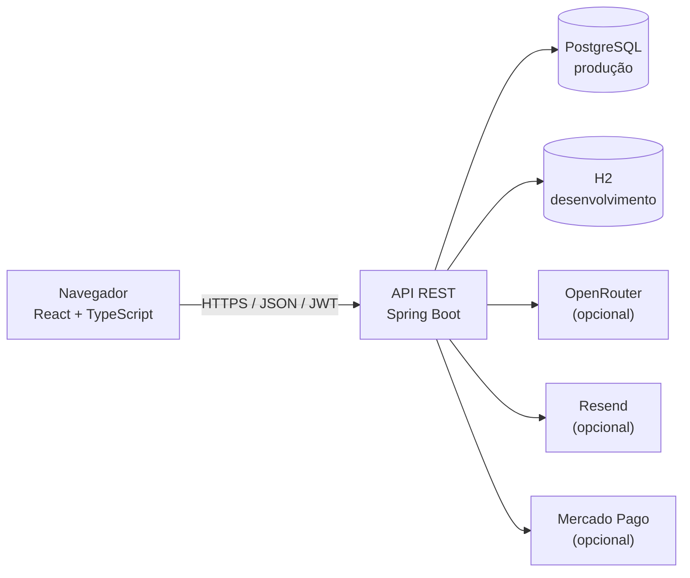

# AETHER AI

Plataforma web de assistente inteligente para conversar com IA, organizar
tarefas e consultar documentos. Construída com Spring Boot, React e TypeScript.

**Descrição sugerida para o GitHub:** Assistente inteligente com chat, tarefas e
documentos, desenvolvido com Spring Boot e React.

**Topics sugeridos:** `spring-boot`, `react`, `typescript`, `ai-assistant`,
`jwt`, `openrouter`, `postgresql`.

[](https://github.com/Duduxpz/Assistente-Inteligente/actions/workflows/ci.yml)

## Funcionalidades

- Cadastro e autenticação por JWT; senhas protegidas com PBKDF2.
- Perfil, preferências e temas claro, escuro ou conforme o sistema.
- Tarefas com prioridade, datas, edição e conclusão.
- Conversas com histórico, renomeação e exclusão.
- Upload, download e exclusão de documentos PDF, TXT e Markdown (até 10 MB).
- Planos Free, Plus e Ultra com limites aplicados pela API.
- Área administrativa protegida por função.
- Integração configurável com OpenRouter; sem provedor, a API retorna erro e
  não inventa respostas.
- Recuperação de senha e checkout recorrente via Mercado Pago.

## Stack

| Área | Tecnologias |
| --- | --- |
| Backend | Java 21, Spring Boot, Maven, Spring Security, Spring Data JPA, Flyway |
| Frontend | React, TypeScript, Vite, Tailwind CSS |
| Banco | H2 no perfil `dev`; PostgreSQL no perfil padrão/produção |
| Testes | JUnit, Spring Boot Test, H2; Oxlint, TypeScript e Vite |
| Integrações | OpenRouter, Resend e Mercado Pago (opcionais) |

## Arquitetura



## Capturas de tela

<!-- Substitua pelos arquivos de imagem quando as capturas estiverem disponíveis. -->

| Visão | Captura |
| --- | --- |
| Aplicação | `docs/screenshots/app.png` |
| Conversa | `docs/screenshots/chat.png` |
| Administração | `docs/screenshots/admin.png` |

## Requisitos

- Java 21 e Maven 3.10+.
- Node.js e npm.
- Docker e Docker Compose para executar a stack em containers.

## Executar com Docker

Na raiz do repositório, copie `.env.example` para `.env`, defina um `JWT_SECRET`
aleatório com pelo menos 32 bytes codificados em Base64 e inicie os serviços:

```powershell
Copy-Item .env.example .env
docker compose --env-file .env -f docker\compose.yml up --build
```

Frontend: `http://localhost:5173`. API: `http://localhost:8080/api/v1`.

## Executar sem Docker

Abra dois terminais PowerShell na raiz. No primeiro, inicie o backend com H2:

```powershell
$bytes = New-Object byte[] 32
$rng = [System.Security.Cryptography.RandomNumberGenerator]::Create()
$rng.GetBytes($bytes)
$env:JWT_SECRET = [Convert]::ToBase64String($bytes)
$env:SPRING_PROFILES_ACTIVE = 'dev'
mvn -f backend\pom.xml spring-boot:run
```

No segundo, instale as dependências e inicie o frontend:

```powershell
cd frontend
npm ci
npm run dev
```

Abra `http://localhost:5173` e crie uma conta. A configuração padrão do
frontend aponta para `http://localhost:8080/api/v1`.

## Variáveis de ambiente

Os arquivos `.env.example` do projeto documentam as variáveis sem credenciais
reais. As principais são:

| Variável | Uso |
| --- | --- |
| `JWT_SECRET` | Chave Base64 aleatória (mínimo 32 bytes) para assinar tokens |
| `DB_URL`, `DB_USERNAME`, `DB_PASSWORD` | Conexão PostgreSQL fora do perfil `dev` |
| `SERVER_PORT` | Porta HTTP do backend |
| `VITE_API_BASE_URL` | URL base da API no frontend |
| `AI_PROVIDER`, `OPENROUTER_API_KEY`, `OPENROUTER_MODEL` | Provedor e modelo de IA |
| `EMAIL_PROVIDER`, `RESEND_API_KEY`, `RESEND_FROM` | E-mail de recuperação |
| `MERCADOPAGO_ACCESS_TOKEN`, `MERCADOPAGO_WEBHOOK_SECRET` | Checkout e webhook |
| `FRONTEND_BASE_URL` | URL pública do frontend usada em links de e-mail/pagamento |

Não versione `.env` nem use credenciais reais em exemplos ou no código. Consulte
[backend/README.md](./backend/README.md) para detalhes das integrações.

## Testes e verificações

Na raiz:

```powershell
mvn -f backend\pom.xml test
cd frontend
npm ci
npm run test:run
npm run lint
npm run build
```

## Roadmap

- [x] Autenticação, tarefas, conversas, documentos e planos.
- [x] Integrações opcionais de IA, recuperação de senha e cobrança recorrente.
- [x] CI, testes automatizados do frontend e cobertura de segurança/limites.
- [ ] Docker Compose, perfil PostgreSQL de produção e observabilidade.
- [ ] Rate limiting, refresh tokens e controles adicionais de segurança/LGPD.
- [ ] Streaming de chat, UX aprimorada e RAG com documentos.
- [ ] Modelos por plano, métricas administrativas, E2E e documentação de contribuição.

## Licença

Distribuído sob a licença MIT. Consulte [LICENSE](./LICENSE).
